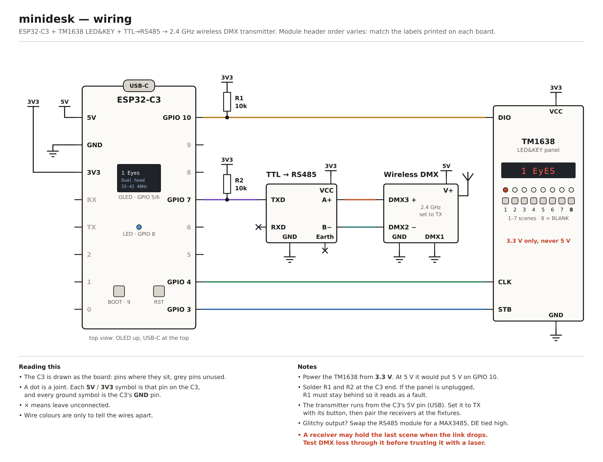

# minidesk

A pocket DMX controller that recalls up to seven static scenes, plus a hard-wired BLANK button. It works with any DMX fixtures on one universe.

It's an ESP32-C3 with a TM1638 "LED&KEY" panel and a TTL-to-RS485 module and a cheap wireless DMX transmitter. 

1) Build the simple circuit below, if you don't want need the wireless you can easily replace this with a 3/5 pin DMX plug.
2) Load your project (.qxw) file from QLC+ into the custom upload tool.
3) Choose which of your scene files maps to each button (1-7) - button 8 is reserved as a 'blank' (assuming 0 values mean stop on your fixtures).
4) Flash your ESP32 over USB. 
5) Check and play!

Why: I lend out my lights and lasers and needed a easy hardware solution for people to use. I use the awesome QLC+ on my laptop, but this isn't a turnkey solution for a party at a house or local hall. These are parts I had around, maybe future versions could have more buttons and OLED display!

## Parts

- ESP32-C3 board with the onboard 0.42" OLED (a plain SuperMini works too, without the status screen)
- TM1638 LED&KEY module (8 buttons, 8 LEDs, 8× 7-seg)
- TTL to RS485 module (auto-direction type, e.g. ePartners TP2003), or a MAX3485 breakout
- 2 × 10k resistors
- 2.4 GHz wireless DMX module (C9 "2 in 1" transmitter/receiver PCB) as the transmitter, plus matching receivers at the fixtures. The box has no DMX socket: output goes only to the transmitter.

## Wiring

Source: [docs/wiring.html](docs/wiring.html) 

| From | To | Notes |
|---|---|---|
| C3 3V3 | TM1638 VCC, RS485 VCC | **3.3 V only for the TM1638** |
| C3 5V | Transmitter V+ | USB 5 V |
| C3 GND | TM1638 GND, RS485 GND, transmitter GND and DMX1 | |
| GPIO 3 | TM1638 STB | |
| GPIO 4 | TM1638 CLK | |
| GPIO 10 | TM1638 DIO | 10k pull-up to 3V3 |
| GPIO 7 | RS485 TXD | 10k pull-up to 3V3 |
| — | RS485 RXD | leave unconnected |
| RS485 A+ | Transmitter DMX3 (Data+) | |
| RS485 B− | Transmitter DMX2 (Data−) | swap A/B first if nothing responds |
| — | RS485 Earth terminal | leave unconnected |

Power the C3 from USB-C; it also powers the transmitter. Fixtures have their own supplies. Set the module to transmit with its button, then pair the receivers.

**Wireless and fail-BLANK:** many 2.4 GHz receivers hold the last frame when the link drops, so a fixture behind one may stay lit after the box stops sending. Test DMX loss through the link (switch the box off mid-scene) before using it with a laser.

## Uploader app

`minidesk-uploader` is a small window for Linux, Windows and macOS: choose the `.qxw`,
pick scenes for buttons, tick "fixtures are safe if DMX stops", press **Upload scenes**.
To pick, select scenes in the list (filter by name) and press 1–7 or click a number; press
the same number again to take them off. Double-click a button in the lower table to set what the box displays.
Scenes named with a number first start on that button. Picks are remembered for each workspace.
It runs the same
converter, refuses to upload if there are errors, finds the box on USB by itself, and
reads the box's boot log afterwards to confirm how many scenes it loaded.
**Install firmware + scenes** sets up a new box; no PlatformIO needed.

Download it from the [releases page](https://github.com/edmonkey-nz/minidesk/releases).
The builds aren't signed, so:

- **Windows:** SmartScreen warns. Choose "More info", then "Run anyway".
- **macOS:** unzip, then right-click the app and choose Open the first time. Apple silicon only.
- **Linux:** `chmod +x minidesk-uploader-linux`. You need to be in the `dialout` group
  (`sudo usermod -aG dialout $USER`, then log out and in).

## Boot messages

| Display | Meaning |
|---|---|
| `boot` | starting |
| `3 SCEnES` | loaded 3 scenes |
| `3 ok 1Er` | 3 loaded, 1 rejected (see serial log for which) |
| `0 SCEnES` | file is valid but has no scenes |
| `no FILE` | no `/scenes.json`: run `pio run -t uploadfs` |
| `JSon Err` / `FMt Err` | file is corrupt or the wrong format version |
| `FS Err` | LittleFS didn't mount (filesystem never flashed?) |

Every one of these leaves the box in BLANK.

## Runtime messages

| Display | Meaning | Output |
|---|---|---|
| `bLAnK` | BLANK active | all channels 0 |
| `1 Tunnel` | scene 1 active | scene 1 |
| `4 EMPty` | button 4 has no scene | unchanged |
| `PAnEL Er` | button reads look like a disconnected panel | BLANK after 0.5 s |
| `dMX Err` | no DMX frame started for 200 ms | — |
| `dMX init` | UART driver failed to start | — |

The decimal point on the last digit and the onboard LED blink only while DMX frames are actually going out.

Shout outs to Massimo Callegari and supporters of https://qlcplus.org/

## Licence

The source in this repo is MIT: see [LICENSE](LICENSE).

The release downloads are built with GPL code, so they are distributed under
[GPL-3.0](https://www.gnu.org/licenses/gpl-3.0.html):

- the firmware links [TM1638plus](https://github.com/gavinlyonsrepo/TM1638plus) (GPL-3.0);
- the uploader app bundles [esptool](https://github.com/espressif/esptool) (GPL-2.0-or-later).

Their full source is this repo plus those libraries, at the versions in `platformio.ini`
and `tools/requirements-uploader.txt`. Other parts: Arduino-ESP32 (LGPL-2.1), ArduinoJson
(MIT), Adafruit SSD1306 and GFX (BSD), littlefs-python (BSD-3), pyserial (BSD-3).
